# Modèle de données SPOK

> Généré le 2026-10-16 depuis `packages/database/prisma/schema.prisma` (32 tables, 13 enums).
> Le schéma fait foi : en cas d'écart, régénérer ce document plutôt que le corriger à la main.
> Version visuelle (MCD Merise par domaine, MLD, enums) : https://claude.ai/artifact/5zSPXaWyg44AJqo1Knh7Zm

## Diagramme des relations

Chaque trait part de la table référencée vers la table qui porte la clé étrangère ; le libellé est le champ de relation.
`||` = obligatoire, `|o` = facultatif, `o{` = plusieurs, `o|` = au plus un.

```mermaid
erDiagram
    Community ||--o{ CommunityEmail : "community"
    Community ||--o{ CommunityMembership : "community"
    Community |o--o{ Invitation : "community"
    Community |o--o{ Space : "community"
    Community |o--o{ Tag : "community"
    CommunityEmail ||--o{ CommunityEmailRecipient : "email"
    Contribution |o--o{ Contribution : "parent"
    Contribution |o--o{ Reaction : "contribution"
    Item ||--o{ Contribution : "item"
    Item ||--o{ DayPlanEntry : "item"
    Item |o--o{ Item : "parent"
    Item ||--o{ ItemBookmark : "item"
    Item ||--o{ ItemRelation : "fromItem"
    Item ||--o{ ItemRelation : "toItem"
    Item ||--o{ ItemTag : "item"
    Item ||--o{ ItemView : "item"
    Item |o--o{ LiveSessionEntry : "item"
    Item ||--o{ ProcessNode : "item"
    Item ||--o{ ProcessLane : "item"
    Item ||--o{ ArticleBlock : "article"
    Item ||--o{ ArticleBlock : "item"
    ProcessLane |o--o{ ProcessNode : "lane"
    Item |o--o{ Reaction : "item"
    LiveSession |o--o| LiveSession : "previousSession"
    LiveSession ||--o{ LiveSessionAgendaItem : "session"
    LiveSession ||--o{ LiveSessionEntry : "session"
    LiveSession ||--o{ LiveSessionInvite : "session"
    LiveSession ||--o{ LiveSessionRole : "session"
    Space |o--o{ AuditLog : "space"
    Space |o--o{ Invitation : "space"
    Space ||--o{ Item : "space"
    Space ||--o{ ProcessNode : "space"
    Space ||--o{ ProcessLane : "space"
    Space ||--o{ LiveSession : "parentSpace"
    Space ||--o| LiveSession : "space"
    Space |o--o{ Space : "parent"
    Space ||--o{ SpaceFavorite : "space"
    Space ||--o{ SpaceMembership : "space"
    Space |o--o{ Tag : "space"
    Tag ||--o{ ItemTag : "tag"
    User |o--o{ ArticleBlock : "addedBy"
    User ||--o{ AuditLog : "user"
    User ||--o{ CalendarFeed : "user"
    User ||--o{ CommunityEmail : "sentBy"
    User ||--o{ CommunityEmailRecipient : "user"
    User ||--o{ CommunityMembership : "user"
    User ||--o{ Contribution : "author"
    User ||--o{ DayPlanEntry : "user"
    User ||--o{ EmailVerificationToken : "user"
    User ||--o{ Invitation : "invitedBy"
    User |o--o{ Item : "assignedTo"
    User |o--o{ Item : "updatedBy"
    User ||--o{ Item : "createdBy"
    User ||--o{ ItemBookmark : "user"
    User ||--o{ ItemTemplate : "createdBy"
    User ||--o{ ItemView : "user"
    User ||--o{ LiveSession : "host"
    User ||--o{ LiveSessionAgendaItem : "presenter"
    User ||--o{ LiveSessionEntry : "user"
    User ||--o{ LiveSessionInvite : "invitedBy"
    User ||--o{ LiveSessionInvite : "user"
    User ||--o{ LiveSessionRole : "user"
    User ||--o{ Notification : "user"
    User ||--o{ PasswordResetToken : "user"
    User ||--o{ PersonalAccessToken : "user"
    User ||--o{ Reaction : "user"
    User ||--o{ SpaceFavorite : "user"
    User ||--o{ SpaceMembership : "user"
```

Tables sans relation déclarée (absentes du diagramme) : `AppConfig` (`app_config`), `RefreshToken` (`refresh_tokens`).

## Tables

### AppConfig (`app_config`)

Configuration globale (clé-valeur JSON)

| Champ | Type | Contraintes | Note |
|---|---|---|---|
| `key` | String | PK |  |
| `value` | Json |  |  |
| `updatedAt` | DateTime | maj auto |  |

### ArticleBlock (`article_blocks`)

Bloc d'un article (item de type ARTICLE, 2026-10-23) : référence ordonnée vers un élément existant, qui reste où il est. Un élément au plus une fois par article ; il peut figurer dans plusieurs articles.

| Champ | Type | Contraintes | Note |
|---|---|---|---|
| `id` | String | PK, cuid |  |
| `articleId` | String | FK → Item (cascade) | l'article |
| `itemId` | String | FK → Item (cascade) | l'élément référencé |
| `position` | Int |  | ordre dans l'article |
| `width` | String | défaut `full` | `full` / `wide` / `medium` |
| `align` | String | défaut `center` | `center` / `left` / `right` (IMAGE, DIAGRAM) |
| `addedById` | String? | FK → User (SetNull) | ses droits de lecture décident à la lecture si le bloc est montré ; null = indisponible |
| `createdAt` | DateTime | défaut now |  |

Unicité `(articleId, itemId)` ; index `itemId`.

### AuditLog (`audit_logs`)

Traçabilité

| Champ | Type | Contraintes | Note |
|---|---|---|---|
| `id` | String | PK, défaut cuid() |  |
| `action` | String |  |  |
| `entity` | String |  |  |
| `entityId` | String |  |  |
| `spaceId` | String? | FK |  |
| `batchId` | String? |  |  |
| `changes` | Json? |  |  |
| `userId` | String | FK |  |
| `createdAt` | DateTime | défaut now() |  |

Clés étrangères : `userId` → User (onDelete par défaut (Prisma)) ; `spaceId` → Space (onDelete SetNull)

Index : (entity, entityId) ; (userId) ; (spaceId, createdAt) ; (batchId)

### CalendarFeed (`calendar_feeds`)

L'url est un lien ICS privé : secret utilisateur, ne jamais la loguer.

| Champ | Type | Contraintes | Note |
|---|---|---|---|
| `id` | String | PK, défaut cuid() |  |
| `userId` | String | FK |  |
| `name` | String |  |  |
| `url` | String |  |  |
| `color` | String | défaut "#3b82f6" |  |
| `enabled` | Boolean | défaut true |  |
| `lastFetchedAt` | DateTime? |  |  |
| `lastError` | String? |  |  |
| `createdAt` | DateTime | défaut now() |  |
| `updatedAt` | DateTime | maj auto |  |

Clés étrangères : `userId` → User (onDelete Cascade)

Index : (userId)

### Community (`communities`)

Communauté

| Champ | Type | Contraintes | Note |
|---|---|---|---|
| `id` | String | PK, défaut cuid() |  |
| `name` | String |  |  |
| `description` | String? |  |  |
| `visibility` | SpaceVisibility | défaut PRIVATE |  |
| `pendingVisibility` | SpaceVisibility? |  | Visibilité demandée, en attente de validation admin |
| `context` | CommunityContext? |  | Contexte d'usage (FORUM/PROJECT), null = neutre « tous » |
| `avatarUrl` | String? |  |  |
| `coverUrl` | String? |  |  |
| `coverPosition` | Int | défaut 50 |  |
| `coverPositionX` | Int | défaut 50 |  |
| `coverZoom` | Int | défaut 100 |  |
| `referentiels` | Json? |  |  |
| `createdAt` | DateTime | défaut now() |  |
| `updatedAt` | DateTime | maj auto |  |

### CommunityEmail (`community_emails`)

| Champ | Type | Contraintes | Note |
|---|---|---|---|
| `id` | String | PK, défaut cuid() |  |
| `communityId` | String | FK |  |
| `subject` | String |  |  |
| `html` | String |  |  |
| `sentById` | String | FK |  |
| `sentAt` | DateTime | défaut now() |  |

Clés étrangères : `communityId` → Community (onDelete Cascade) ; `sentById` → User (onDelete par défaut (Prisma))

### CommunityEmailRecipient (`community_email_recipients`)

| Champ | Type | Contraintes | Note |
|---|---|---|---|
| `id` | String | PK, défaut cuid() |  |
| `emailId` | String | FK |  |
| `userId` | String | FK |  |
| `sentAt` | DateTime | défaut now() |  |

Clés étrangères : `emailId` → CommunityEmail (onDelete Cascade) ; `userId` → User (onDelete par défaut (Prisma))

Unicité : (emailId, userId)

### CommunityMembership (`community_memberships`)

Appartenance à une communauté

| Champ | Type | Contraintes | Note |
|---|---|---|---|
| `id` | String | PK, défaut cuid() |  |
| `userId` | String | FK |  |
| `communityId` | String | FK |  |
| `role` | CommunityRole |  |  |
| `joinedAt` | DateTime | défaut now() |  |
| `order` | Int | défaut 0 |  |
| `muted` | Boolean | défaut false |  |

Clés étrangères : `userId` → User (onDelete Cascade) ; `communityId` → Community (onDelete Cascade)

Unicité : (userId, communityId)

### Contribution (`contributions`)

Contributions aux éléments

| Champ | Type | Contraintes | Note |
|---|---|---|---|
| `id` | String | PK, défaut cuid() |  |
| `content` | String |  |  |
| `itemId` | String | FK |  |
| `authorId` | String | FK |  |
| `parentId` | String? | FK |  |
| `createdAt` | DateTime | défaut now() |  |
| `updatedAt` | DateTime | maj auto |  |

Clés étrangères : `itemId` → Item (onDelete Cascade) ; `authorId` → User (onDelete Cascade) ; `parentId` → Contribution (onDelete Cascade)

Index : (itemId) ; (authorId) ; (parentId)

### DayPlanEntry (`day_plan_entries`)

L'état "fait" reste porté par Item.status — pas de deuxième vérité ici.

| Champ | Type | Contraintes | Note |
|---|---|---|---|
| `id` | String | PK, défaut cuid() |  |
| `userId` | String | FK |  |
| `date` | DateTime |  |  |
| `itemId` | String | FK |  |
| `position` | Int | défaut 0 |  |
| `source` | String | défaut "manual" | 'auto' (suggestion acceptée) / 'manual' (pioche) |
| `plannedStart` | DateTime? |  | début du bloc sur la grille du jour (brouillon perso — jamais les dates de l'item) |
| `plannedDuration` | Int? |  | durée en minutes (15–720), null si non placé |
| `createdAt` | DateTime | défaut now() |  |

Clés étrangères : `userId` → User (onDelete Cascade) ; `itemId` → Item (onDelete Cascade)

Unicité : (userId, date, itemId)

Index : (userId, date)

### EmailVerificationToken (`email_verification_tokens`)

Email verification tokens

| Champ | Type | Contraintes | Note |
|---|---|---|---|
| `id` | String | PK, défaut cuid() |  |
| `token` | String | unique |  |
| `userId` | String | FK |  |
| `expiresAt` | DateTime |  |  |
| `createdAt` | DateTime | défaut now() |  |
| `used` | Boolean | défaut false |  |

Clés étrangères : `userId` → User (onDelete Cascade)

Index : (userId)

### Invitation (`invitations`)

Invitation à rejoindre une communauté ou un espace

| Champ | Type | Contraintes | Note |
|---|---|---|---|
| `id` | String | PK, défaut cuid() |  |
| `email` | String |  |  |
| `token` | String | unique, défaut uuid() |  |
| `status` | InvitationStatus | défaut PENDING |  |
| `role` | String |  | OWNER / MEMBER (valeurs communes à Role et CommunityRole, cf. routes/invitations.ts) |
| `message` | String? |  | Optional message from inviter |
| `communityId` | String? | FK |  |
| `spaceId` | String? | FK |  |
| `invitedById` | String | FK |  |
| `expiresAt` | DateTime |  |  |
| `respondedAt` | DateTime? |  |  |
| `createdAt` | DateTime | défaut now() |  |
| `updatedAt` | DateTime | maj auto |  |

Clés étrangères : `invitedById` → User (onDelete Cascade) ; `communityId` → Community (onDelete Cascade) ; `spaceId` → Space (onDelete Cascade)

Index : (email) ; (communityId) ; (spaceId)

### Item (`items`)

Élément générique (note, projet, tâche)

| Champ | Type | Contraintes | Note |
|---|---|---|---|
| `id` | String | PK, défaut cuid() |  |
| `type` | ItemType |  |  |
| `title` | String |  |  |
| `description` | String? |  |  |
| `content` | Json? |  |  |
| `url` | String? |  |  |
| `status` | String? |  |  |
| `priority` | Int? |  |  |
| `position` | Int | défaut 0 |  |
| `dueDate` | DateTime? |  |  |
| `startDate` | DateTime? |  |  |
| `endDate` | DateTime? |  |  |
| `manualHorizon` | HorizonBucket? |  |  |
| `horizonSetAt` | DateTime? |  |  |
| `createdAt` | DateTime | défaut now() |  |
| `updatedAt` | DateTime | maj auto |  |
| `spaceId` | String | FK |  |
| `createdById` | String | FK |  |
| `updatedById` | String? | FK |  |
| `assignedToId` | String? | FK |  |
| `assignedAt` | DateTime? |  |  |
| `assignedById` | String? |  |  |
| `lockedAt` | DateTime? |  |  |
| `sourceItemId` | String? |  |  |
| `sourceSpaceId` | String? |  |  |
| `parentId` | String? | FK |  |

Clés étrangères : `spaceId` → Space (onDelete Cascade) ; `createdById` → User (onDelete par défaut (Prisma)) ; `updatedById` → User (onDelete par défaut (Prisma)) ; `assignedToId` → User (onDelete par défaut (Prisma)) ; `parentId` → Item (onDelete SetNull)

Index : (spaceId) ; (createdById) ; (assignedToId) ; (parentId) ; (sourceItemId)

### ItemBookmark (`item_bookmarks`)

| Champ | Type | Contraintes | Note |
|---|---|---|---|
| `userId` | String | FK |  |
| `itemId` | String | FK |  |
| `createdAt` | DateTime | défaut now() |  |

Clés étrangères : `userId` → User (onDelete Cascade) ; `itemId` → Item (onDelete Cascade)

### ItemRelation (`item_relations`)

Relations entre éléments

| Champ | Type | Contraintes | Note |
|---|---|---|---|
| `id` | String | PK, défaut cuid() |  |
| `fromItemId` | String | FK |  |
| `toItemId` | String | FK |  |
| `type` | String |  | RELATION_TYPES de @spok/shared : blocks, relates, implements, drives (validé par l'API) |
| `label` | String? |  | commentaire/note sur la relation |

Clés étrangères : `fromItemId` → Item (onDelete Cascade) ; `toItemId` → Item (onDelete Cascade)

Unicité : (fromItemId, toItemId, type)

### ItemTag (`item_tags`)

| Champ | Type | Contraintes | Note |
|---|---|---|---|
| `itemId` | String | FK |  |
| `tagId` | String | FK |  |

Clés étrangères : `itemId` → Item (onDelete Cascade) ; `tagId` → Tag (onDelete Cascade)

### ItemTemplate (`item_templates`)

par tous les utilisateurs, pour le moment (2026-09-12).

| Champ | Type | Contraintes | Note |
|---|---|---|---|
| `id` | String | PK, défaut cuid() |  |
| `name` | String |  |  |
| `description` | String? |  |  |
| `structure` | Json |  |  |
| `createdById` | String | FK |  |
| `createdAt` | DateTime | défaut now() |  |
| `updatedAt` | DateTime | maj auto |  |

Clés étrangères : `createdById` → User (onDelete Cascade)

Index : (createdById)

### ItemView (`item_views`)

Suivi de lecture des items (pour le feed d'activité)

| Champ | Type | Contraintes | Note |
|---|---|---|---|
| `userId` | String | FK |  |
| `itemId` | String | FK |  |
| `viewedAt` | DateTime | défaut now(), maj auto |  |
| `markedUnread` | Boolean | défaut false |  |

Clés étrangères : `userId` → User (onDelete Cascade) ; `itemId` → Item (onDelete Cascade)

### LiveSession (`live_sessions`)

previousSessionId : séance dont celle-ci est la « suite » (une seule suite directe par séance, @unique).

| Champ | Type | Contraintes | Note |
|---|---|---|---|
| `id` | String | PK, défaut cuid() |  |
| `spaceId` | String | unique, FK |  |
| `parentSpaceId` | String | FK |  |
| `hostId` | String | FK |  |
| `status` | LiveSessionStatus | défaut PREPARED |  |
| `controllerId` | String? |  |  |
| `currentEntryId` | String? |  |  |
| `startedAt` | DateTime | défaut now() |  |
| `liveAt` | DateTime? |  |  |
| `endedAt` | DateTime? |  |  |
| `previousSessionId` | String? | unique, FK |  |

Clés étrangères : `spaceId` → Space (onDelete Cascade) ; `parentSpaceId` → Space (onDelete Cascade) ; `hostId` → User (onDelete Cascade) ; `previousSessionId` → LiveSession (onDelete SetNull)

Index : (parentSpaceId)

### LiveSessionAgendaItem (`live_session_agenda_items`)

title : titre au moment de l'ajout (affichable même si la source devient inaccessible ou est supprimée).

| Champ | Type | Contraintes | Note |
|---|---|---|---|
| `id` | String | PK, défaut cuid() |  |
| `sessionId` | String | FK |  |
| `presenterId` | String | FK |  |
| `sourceItemId` | String |  |  |
| `sourceSpaceId` | String |  |  |
| `title` | String |  |  |
| `position` | Int |  |  |
| `presentedAt` | DateTime? |  |  |
| `createdAt` | DateTime | défaut now() |  |

Clés étrangères : `sessionId` → LiveSession (onDelete Cascade) ; `presenterId` → User (onDelete Cascade)

Index : (sessionId, position)

### LiveSessionEntry (`live_session_entries`)

itemTitle : titre figé à l'affichage, survit à la suppression de la copie (itemId → null).

| Champ | Type | Contraintes | Note |
|---|---|---|---|
| `id` | String | PK, défaut cuid() |  |
| `sessionId` | String | FK |  |
| `kind` | LiveSessionEntryKind |  |  |
| `userId` | String | FK |  |
| `itemId` | String? | FK |  |
| `itemTitle` | String? |  |  |
| `createdAt` | DateTime | défaut now() |  |

Clés étrangères : `sessionId` → LiveSession (onDelete Cascade) ; `userId` → User (onDelete Cascade) ; `itemId` → Item (onDelete SetNull)

Index : (sessionId, createdAt)

### LiveSessionInvite (`live_session_invites`)

de l'espace de séance (PRIVÉ) uniquement. Retirer l'invitation retire aussi cette adhésion.

| Champ | Type | Contraintes | Note |
|---|---|---|---|
| `id` | String | PK, défaut cuid() |  |
| `sessionId` | String | FK |  |
| `userId` | String | FK |  |
| `invitedById` | String | FK |  |
| `createdMembership` | Boolean | défaut false |  |
| `createdAt` | DateTime | défaut now() |  |

Clés étrangères : `sessionId` → LiveSession (onDelete Cascade) ; `userId` → User (onDelete Cascade) ; `invitedById` → User (onDelete Cascade)

Unicité : (sessionId, userId)

### LiveSessionRole (`live_session_roles`)

Rôle explicite dans une séance. Les participants n'ont pas de ligne (membres de l'espace de séance).

| Champ | Type | Contraintes | Note |
|---|---|---|---|
| `id` | String | PK, défaut cuid() |  |
| `sessionId` | String | FK |  |
| `userId` | String | FK |  |
| `role` | LiveSessionRoleType |  |  |

Clés étrangères : `sessionId` → LiveSession (onDelete Cascade) ; `userId` → User (onDelete Cascade)

Unicité : (sessionId, userId)

### Notification (`notifications`)

Notifications

| Champ | Type | Contraintes | Note |
|---|---|---|---|
| `id` | String | PK, défaut cuid() |  |
| `userId` | String | FK |  |
| `type` | NotificationType |  |  |
| `title` | String |  |  |
| `message` | String? |  |  |
| `link` | String? |  | URL relative pour navigation (ex: /spaces/xxx) |
| `read` | Boolean | défaut false |  |
| `metadata` | Json? |  | données supplémentaires (actorName, spaceName, etc.) |
| `createdAt` | DateTime | défaut now() |  |

Clés étrangères : `userId` → User (onDelete Cascade)

Index : (userId, read, createdAt) ; (userId, createdAt)

### PasswordResetToken (`password_reset_tokens`)

Password reset tokens

| Champ | Type | Contraintes | Note |
|---|---|---|---|
| `id` | String | PK, défaut cuid() |  |
| `token` | String | unique |  |
| `userId` | String | FK |  |
| `expiresAt` | DateTime |  |  |
| `createdAt` | DateTime | défaut now() |  |
| `used` | Boolean | défaut false |  |

Clés étrangères : `userId` → User (onDelete Cascade)

Index : (userId)

### PersonalAccessToken (`personal_access_tokens`)

Révocation = revokedAt non null (jamais de suppression physique : traçabilité audit).

| Champ | Type | Contraintes | Note |
|---|---|---|---|
| `id` | String | PK, défaut cuid() |  |
| `userId` | String | FK |  |
| `name` | String |  |  |
| `tokenHash` | String | unique |  |
| `tokenPrefix` | String |  |  |
| `scope` | String | défaut "write" |  |
| `lastUsedAt` | DateTime? |  |  |
| `expiresAt` | DateTime? |  |  |
| `revokedAt` | DateTime? |  |  |
| `createdAt` | DateTime | défaut now() |  |

Clés étrangères : `userId` → User (onDelete Cascade)

Index : (userId)

### ProcessNode (`process_nodes`)

Position d'un item sur le canevas de la vue Process de son espace (2026-10-20). Une ligne = item placé ; absence de ligne = item « non placé ». Partagé entre membres.

| Champ | Type | Contraintes | Note |
|---|---|---|---|
| `id` | String | PK, défaut cuid() |  |
| `spaceId` | String | FK |  |
| `itemId` | String | FK |  |
| `x` | Float |  |  |
| `y` | Float |  |  |
| `laneId` | String? | FK | null = item libre (x/y absolus) ; sinon x/y relatifs au couloir |
| `updatedAt` | DateTime | updatedAt |  |

Clés étrangères : `spaceId` → Space (onDelete Cascade) ; `itemId` → Item (onDelete Cascade) ; `laneId` → ProcessLane (onDelete SetNull)

Unicité : (spaceId, itemId)

Index : (spaceId), (laneId)

### ProcessLane (`process_lanes`)

Couloir (flux) de la vue Process (2026-10-21) : bande horizontale nommée par un item de l'espace, où l'on range visuellement des items (aucun effet sur parent/relations). position = ordre d'empilement, de haut en bas.

| Champ | Type | Contraintes | Note |
|---|---|---|---|
| `id` | String | PK, défaut cuid() |  |
| `spaceId` | String | FK |  |
| `itemId` | String | FK |  |
| `position` | Int | défaut 0 |  |
| `createdAt` | DateTime | défaut now() |  |

Clés étrangères : `spaceId` → Space (onDelete Cascade) ; `itemId` → Item (onDelete Cascade)

Unicité : (spaceId, itemId)

Index : (spaceId)

### Reaction (`reactions`)

Réactions qualitatives sur items et contributions

| Champ | Type | Contraintes | Note |
|---|---|---|---|
| `id` | String | PK, défaut cuid() |  |
| `reactionType` | String |  | ex: "pertinent", "inexact", "inadapte", "j_adore", "trollage" |
| `userId` | String | FK |  |
| `itemId` | String? | FK |  |
| `contributionId` | String? | FK |  |
| `createdAt` | DateTime | défaut now() |  |

Clés étrangères : `userId` → User (onDelete Cascade) ; `itemId` → Item (onDelete Cascade) ; `contributionId` → Contribution (onDelete Cascade)

Unicité : (userId, itemId) ; (userId, contributionId)

Index : (itemId) ; (contributionId)

### RefreshToken (`refresh_tokens`)

(routes/auth.ts generateTokens) et purge explicite à la suppression d'un utilisateur.

| Champ | Type | Contraintes | Note |
|---|---|---|---|
| `id` | String | PK, défaut cuid() |  |
| `token` | String | unique |  |
| `userId` | String |  |  |
| `expiresAt` | DateTime |  |  |
| `createdAt` | DateTime | défaut now() |  |

Index : (userId)

### Space (`spaces`)

Espace (personnel ou groupe)

| Champ | Type | Contraintes | Note |
|---|---|---|---|
| `id` | String | PK, défaut cuid() |  |
| `name` | String |  |  |
| `description` | String? |  |  |
| `type` | SpaceType |  |  |
| `communityId` | String? | FK |  |
| `avatarUrl` | String? |  |  |
| `coverUrl` | String? |  |  |
| `coverPosition` | Int | défaut 50 |  |
| `coverPositionX` | Int | défaut 50 |  |
| `coverZoom` | Int | défaut 100 |  |
| `createdAt` | DateTime | défaut now() |  |
| `updatedAt` | DateTime | maj auto |  |
| `parentId` | String? | FK |  |
| `defaultRole` | Role? |  | Auto-join role for new community members (null = no auto-join) |
| `visibility` | SpaceVisibility? |  | null = inherit from parent space or community |
| `defaultView` | String? |  | Default view mode when entering the space (list, kanban, mindmap...) |
| `position` | Int | défaut 0 | Ordre manuel parmi ses frères (même parent / même racine de communauté), puis nom |

Clés étrangères : `communityId` → Community (onDelete SetNull) ; `parentId` → Space (onDelete SetNull)

Index : (communityId) ; (parentId)

### SpaceFavorite (`space_favorites`)

| Champ | Type | Contraintes | Note |
|---|---|---|---|
| `userId` | String | FK |  |
| `spaceId` | String | FK |  |
| `createdAt` | DateTime | défaut now() |  |

Clés étrangères : `userId` → User (onDelete Cascade) ; `spaceId` → Space (onDelete Cascade)

### SpaceMembership (`space_memberships`)

Appartenance à un espace

| Champ | Type | Contraintes | Note |
|---|---|---|---|
| `id` | String | PK, défaut cuid() |  |
| `userId` | String | FK |  |
| `spaceId` | String | FK |  |
| `role` | Role |  |  |
| `joinedAt` | DateTime | défaut now() |  |
| `preferences` | Json? |  | Préférences UI par vue (mindmap: collapsed, pinned, portals) |

Clés étrangères : `userId` → User (onDelete Cascade) ; `spaceId` → Space (onDelete Cascade)

Unicité : (userId, spaceId)

### Tag (`tags`)

Tags

| Champ | Type | Contraintes | Note |
|---|---|---|---|
| `id` | String | PK, défaut cuid() |  |
| `name` | String |  |  |
| `color` | String? |  |  |
| `spaceId` | String? | FK |  |
| `communityId` | String? | FK |  |

Clés étrangères : `spaceId` → Space (onDelete Cascade) ; `communityId` → Community (onDelete Cascade)

Unicité : (spaceId, name) ; (communityId, name)

Index : (communityId)

### User (`users`)

Utilisateur

| Champ | Type | Contraintes | Note |
|---|---|---|---|
| `id` | String | PK, défaut cuid() |  |
| `email` | String | unique |  |
| `emailVerified` | Boolean | défaut false |  |
| `passwordHash` | String |  |  |
| `name` | String |  |  |
| `avatarUrl` | String? |  |  |
| `globalRole` | GlobalRole | défaut USER |  |
| `themePreference` | String | défaut "system" |  |
| `notificationPreferences` | Json? |  | { INVITATION: "all", ASSIGNMENT: "all", CONTRIBUTION: "in_app", MENTION: "all" } |
| `disabledAt` | DateTime? |  |  |
| `lastLoginAt` | DateTime? |  |  |
| `mcpAccessGrantedAt` | DateTime? |  |  |
| `mcpAccessRequestedAt` | DateTime? |  |  |
| `createdAt` | DateTime | défaut now() |  |
| `updatedAt` | DateTime | maj auto |  |

## Enums

- **CommunityContext** : `FORUM`, `PROJECT`, `JDR`
- **CommunityRole** : `OWNER`, `MEMBER`
- **GlobalRole** : `USER`, `ADMIN`
- **HorizonBucket** : `NOW`, `TODAY`, `WEEK`, `MONTH`, `LATER`
- **InvitationStatus** : `PENDING`, `ACCEPTED`, `DECLINED`, `CANCELLED`
- **ItemType** : `UNDEFINED`, `NOTE`, `PROJECT`, `TASK`, `MEETING`, `PERIOD`, `LINK`, `CONFIG`, `DOCUMENT`, `IMAGE`, `BUG`, `DIAGRAM`
- **LiveSessionEntryKind** : `DISPLAY`, `JOIN`
- **LiveSessionRoleType** : `HOST`, `PRESENTER`
- **LiveSessionStatus** : `PREPARED`, `LIVE`, `ENDED`
- **NotificationType** : `INVITATION`, `ASSIGNMENT`, `CONTRIBUTION`, `MENTION`, `EMAIL_VERIFICATION`, `NEW_USER`, `AUDIT_ALERT`, `MCP_ACCESS_REQUEST`, `MCP_ACCESS_DENIED`
- **Role** : `OWNER`, `MEMBER`
- **SpaceType** : `PERSONAL`, `GROUP`
- **SpaceVisibility** : `OPEN`, `READONLY`, `PRIVATE`
